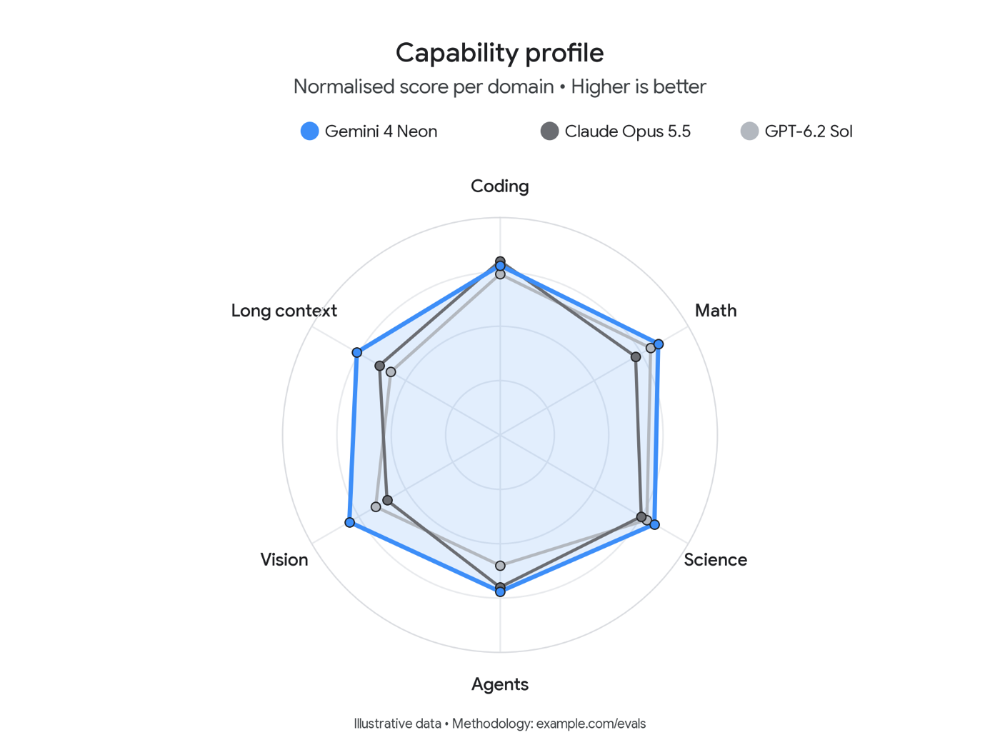

# clean-charts — clean benchmark charts for Claude Code and AI agents

**clean-charts** is an [Agent Skill](https://agentskills.io) for Claude Code and other coding agents that draws clean, publication-ready benchmark and comparison charts with Python and matplotlib. The charts follow the style of AI model-launch posts such as the Google / DeepMind Gemini blogs:
- one blue "hero" model and grey competitors
- value labels on the bars
- a short subtitle such as "Higher is better"
- a methodology footer

Ask in plain English ("make a bar chart of these scores, model A is ours") or attach a screenshot to recreate. The agent writes the script, renders the PNG, checks it visually and fixes any overlaps.


## Install

**Claude Code (plugin marketplace)**

```
/plugin install clean-charts --marketplace zamminhduy123/clean-charts
```

or, on older versions:

```
/plugin marketplace add zamminhduy123/clean-charts
/plugin install clean-charts@clean-charts
```

**Any agent that supports Agent Skills** (Claude Code, Codex, Cursor, Gemini CLI, …) via [skills.sh](https://skills.sh):

```bash
npx skills add zamminhduy123/clean-charts
```

**Manual**

```bash
git clone https://github.com/zamminhduy123/clean-charts
ln -s "$PWD/clean-charts/skills/clean-charts" ~/.claude/skills/clean-charts
```

**Dependencies:**

```bash
pip install matplotlib fonttools
python3 ~/.claude/skills/clean-charts/scripts/install_font.py   # optional: Google Sans (OFL)
```

## Chart types

| | |
|---|---|
|  **Outlined bars** |  **Stacked pass@k / k-attempt bars** |
|  **Cost vs. quality lines** |  **Multi-panel slide** |
|  **Slide with metric cards** |  **Scatter + Pareto frontier** |
|  **Pie** |  **Doughnut** |
|  **Area** |  **Radar** |

Each image has a matching `.py` script in [`skills/clean-charts/examples/`](skills/clean-charts/examples/).

## Example prompts

- "Make a clean bar chart: SWE-bench Verified — Model A 78.2%, Model B 80.1%, Model C 76.4%. Model A is ours."
- "Recreate this chart in Python" *(attach a screenshot of a benchmark chart)*
- "Slide with a headline and two cards: quality 61 / 59 / 57 and cost $1.20 / $4.10 / $2.30 for our model and two competitors."
- "Radar chart comparing three models on coding, math, science, agents, vision and long context."

## FAQ

**How do I make charts that look like Google's Gemini benchmark charts?**
Install this skill and ask your agent for a chart "in Google launch style", or attach a screenshot. The skill encodes the style rules:
- a blue hero series with grey competitors
- Google Sans with Medium-weight titles
- a "Metric • Setting • Higher is better" subtitle
- two-line model names under the bars
- a methodology footer

**Can it recreate a chart from a screenshot?**
Yes. The agent measures pixel positions on the screenshot, builds a canvas of the same size, uses the printed values exactly, and flags any values it had to estimate from bar heights.

**Does it need Google Sans?**
No. Without it, charts fall back to Helvetica or Arial. `scripts/install_font.py` downloads Google Sans from [google/fonts](https://github.com/google/fonts/tree/main/ofl/googlesans) under the OFL and writes static weights, because matplotlib can't use variable-font weights.

**Can I use the helpers without an agent?**
Yes:

```python
import sys; sys.path.insert(0, "skills/clean-charts/scripts")
from gstyle import *
setup()
```

`gstyle` provides:
- palette constants
- `style_axes`, `header`, `footer` and `value_labels`
- a pixel-coordinate `canvas`
- rounded `bar` / `hbar` and `pill`

**Does it invent benchmark numbers?**
No. The skill tells the agent to use only numbers the user gives or that are printed on a reference image, and to mark any estimates.

## Repository layout

```
.claude-plugin/          plugin.json + marketplace.json (Claude Code plugin marketplace)
skills/clean-charts/
  SKILL.md               style rules + workflow the agent follows
  scripts/gstyle.py      matplotlib helpers
  scripts/install_font.py
  examples/              one worked script + PNG per chart type
llms.txt                 summary for LLMs and answer engines
AGENTS.md                instructions for agents working on this repo
```

## Disclaimer

This project is not affiliated with or endorsed by Google. It imitates a general visual style and contains no Google logos or font files.

The bar, line and slide examples recreate charts that Google published:
- [Introducing Gemini 4 Neon](https://blog.google/innovation-and-ai/models-and-research/gemini-models/introducing-gemini-4-neon/)
- [Multimodal Knowledge Agents benchmark](https://blog.google/innovation-and-ai/models-and-research/gemini-models/multimodal-knowledge-agent-benchmark/)
- the Gemini 3 Deep Think announcement

Some unlabeled segments in those examples were estimated from pixel heights. The pie, doughnut, area, scatter and radar examples use illustrative data.

## License

[MIT](LICENSE)
