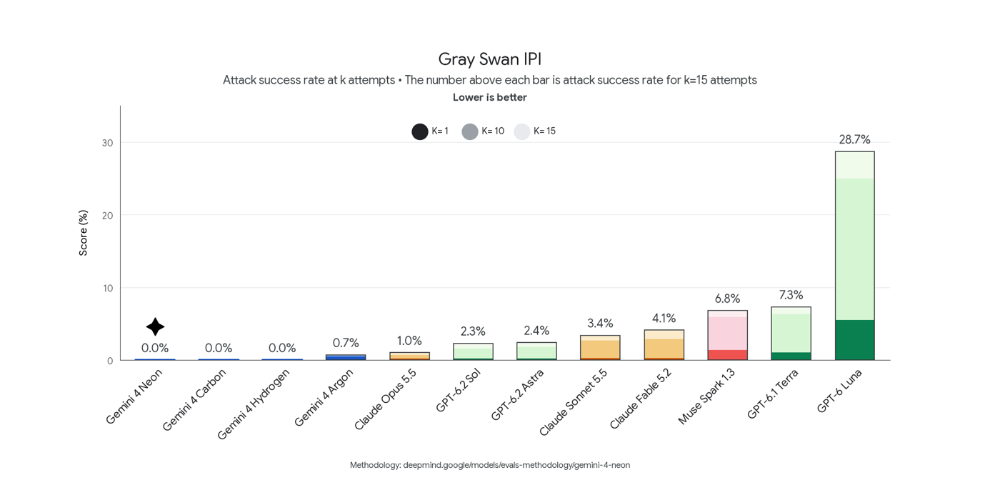
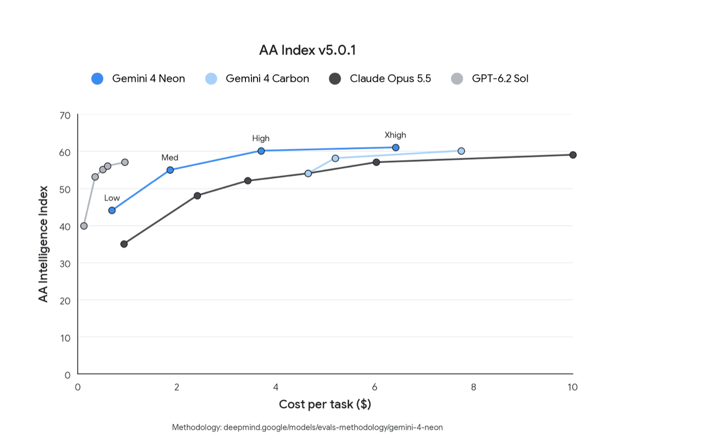
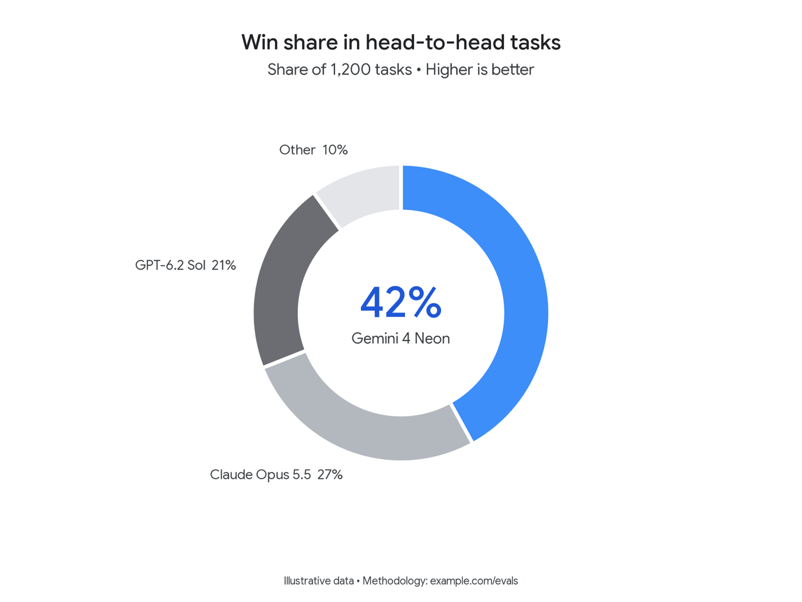

# clean-charts 📊

### Want some Google-clean charts?

You know the ones. A model launch post drops, and the benchmark charts are *so* clean: one confident blue bar, polite grey competitors, numbers sitting on top, a calm little "Higher is better" under the title.

Then you open matplotlib and get... this:

> default blue, default orange, a legend covering your data, ticks everywhere, and DejaVu Sans staring back at you.

**clean-charts** is an [Agent Skill](https://agentskills.io) that teaches Claude Code, Codex, Cursor, Gemini CLI and friends to draw charts in that model-launch style with Python + matplotlib. Tell your agent what you want in plain English, or drop in a screenshot and say "make mine look like this". It writes the script, renders the PNG, looks at it, and fixes its own overlaps before you see them.


## Get it (30 seconds)

**Claude Code**

```
/plugin install clean-charts --marketplace zamminhduy123/clean-charts
```

<details>
<summary>Older Claude Code?</summary>

```
/plugin marketplace add zamminhduy123/clean-charts
/plugin install clean-charts@clean-charts
```
</details>

**Any other agent** (Codex, Cursor, Gemini CLI, OpenCode, Windsurf, …) via [skills.sh](https://skills.sh):

```bash
npx skills add zamminhduy123/clean-charts
```

**Old-school**

```bash
git clone https://github.com/zamminhduy123/clean-charts
ln -s "$PWD/clean-charts/skills/clean-charts" ~/.claude/skills/clean-charts
```

**Then, once:**

```bash
pip install matplotlib fonttools
python3 ~/.claude/skills/clean-charts/scripts/install_font.py   # optional, but it's where the magic is
```

## Things it can draw

| | |
|---|---|
|  **Outlined bars**: the classic |  **Stacked pass@k**: "1 try vs 10 tries" |
|  **Cost vs. quality**: for when you're cheaper *and* better |  **Multi-panel slide**: four benchmarks, one glance |
|  **Metric cards**: keynote energy |  **Scatter + Pareto**: who's on the frontier |
|  **Pie**: yes, even pie |  **Doughnut**: pie with a hole |
|  **Area**: numbers going up |  **Radar**: the spider web |

Every picture has its `.py` next to it in [`skills/clean-charts/examples/`](skills/clean-charts/examples/). Steal freely.

## Just ask

> "Bar chart: SWE-bench Verified, Model A 78.2%, Model B 80.1%, Model C 76.4%. A is ours."

> "Recreate this chart." *(paste screenshot)*

> "Slide with a headline and two cards: quality 61 / 59 / 57, cost $1.20 / $4.10 / $2.30."

> "Radar chart of three models on coding, math, science, agents, vision and long context."

## The house rules

What makes it look "Google-clean", baked into the skill:

- 🔵 **One hero.** Your model is blue. Everyone else is grey. Sorry, everyone else.
- 🔤 **Google Sans**, Medium weight for titles. It falls back to Helvetica/Arial if you don't have it.
- 🏷️ **Numbers on the bars**, not hidden in a legend.
- 🧭 **A subtitle that explains itself**: `Metric • Setting • Higher is better`.
- 🧹 **No chart junk**: left and bottom spines only, a whisper of grid.
- 📝 **A methodology footer**, because you're honest.

## FAQ

**Does it make up numbers?**
No. It uses only the numbers you give it or the ones printed on your screenshot. If it has to estimate one from a bar height, it says so.

**Can I skip the agent and use the helpers myself?**
Yes:

```python
import sys; sys.path.insert(0, "skills/clean-charts/scripts")
from gstyle import *
setup()
```

You get the palette, `style_axes`, `header`, `footer`, `value_labels`, a pixel-coordinate `canvas`, rounded `bar` / `hbar`, and `pill`.

**Why does the font installer exist?**
matplotlib can't pick weights from variable fonts, so `install_font.py` downloads Google Sans from [google/fonts](https://github.com/google/fonts/tree/main/ofl/googlesans) (OFL) and writes static Regular, Medium and Bold files.

## What's inside

```
.claude-plugin/          plugin + marketplace manifests
skills/clean-charts/
  SKILL.md               the style rules and workflow the agent follows
  scripts/gstyle.py      matplotlib helpers
  scripts/install_font.py
  examples/              one script + PNG per chart type
llms.txt                 the short version, for LLMs
AGENTS.md                notes for agents hacking on this repo
```

## Fine print

This project is not affiliated with or endorsed by Google. It borrows a general visual vibe and ships no Google logos or font files.

The bar, line and slide examples recreate charts Google published in [Introducing Gemini 4 Neon](https://blog.google/innovation-and-ai/models-and-research/gemini-models/introducing-gemini-4-neon/), the [Multimodal Knowledge Agents benchmark](https://blog.google/innovation-and-ai/models-and-research/gemini-models/multimodal-knowledge-agent-benchmark/) post and the Gemini 3 Deep Think announcement. A few unlabeled segments were estimated from pixel heights. The pie, doughnut, area, scatter and radar examples use made-up data.

[MIT](LICENSE). Go make something pretty.
