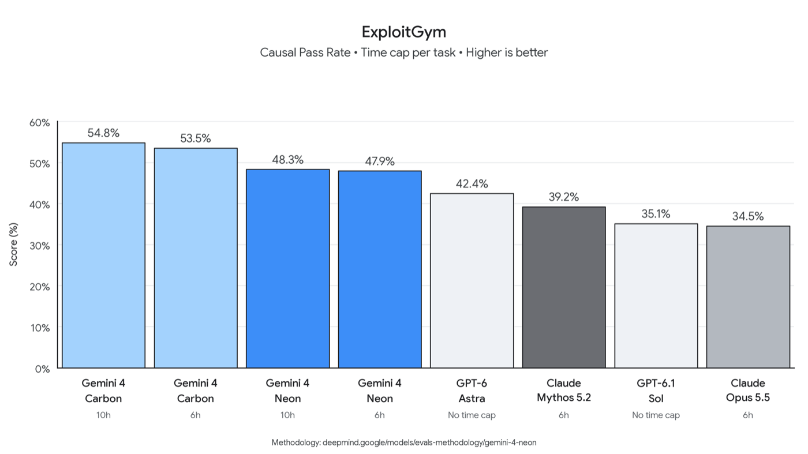
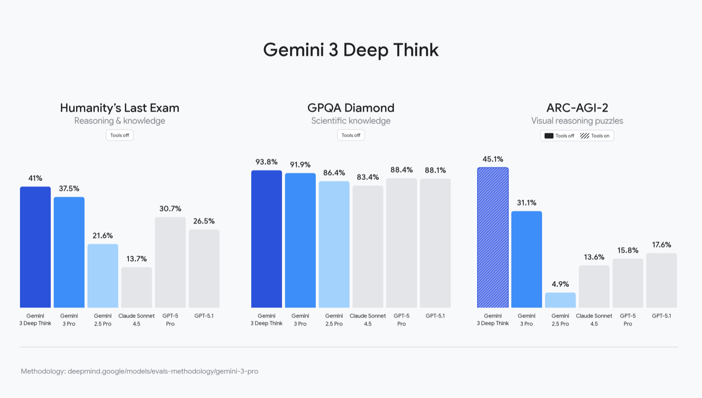
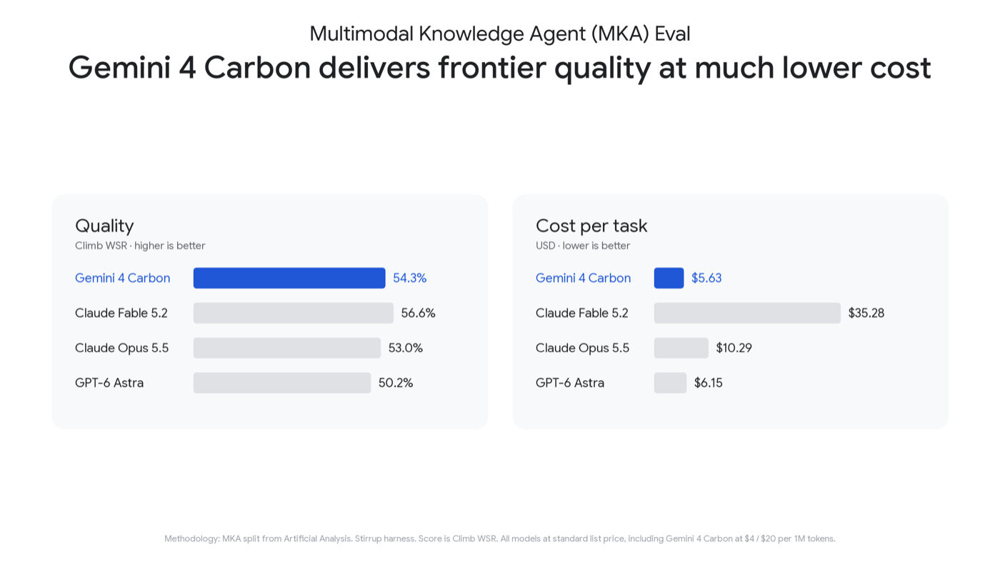
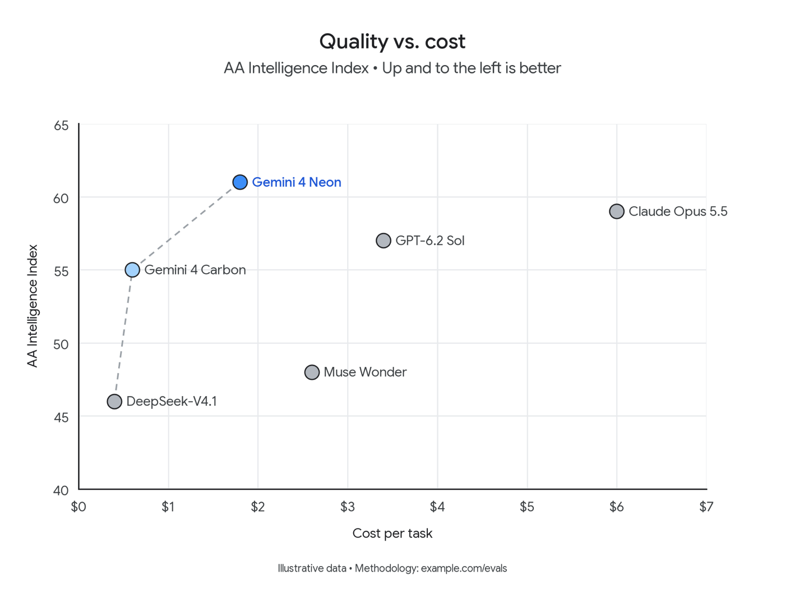
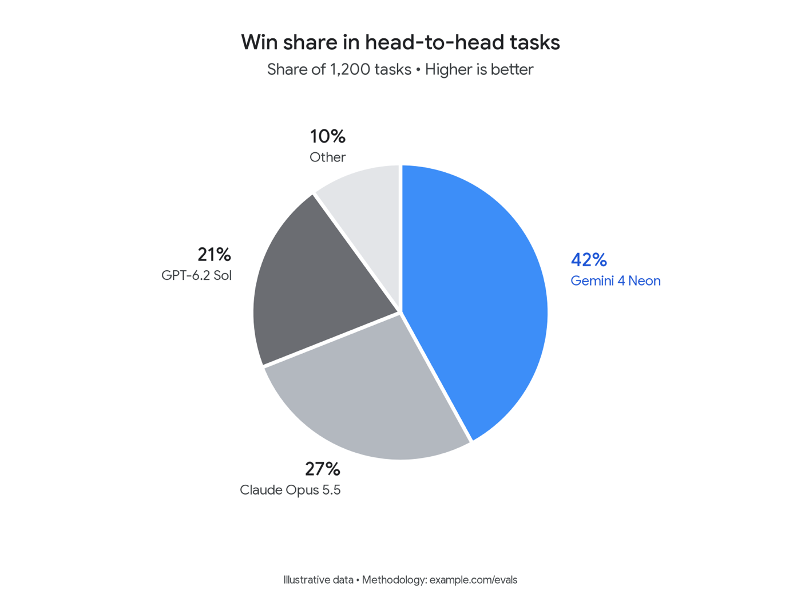
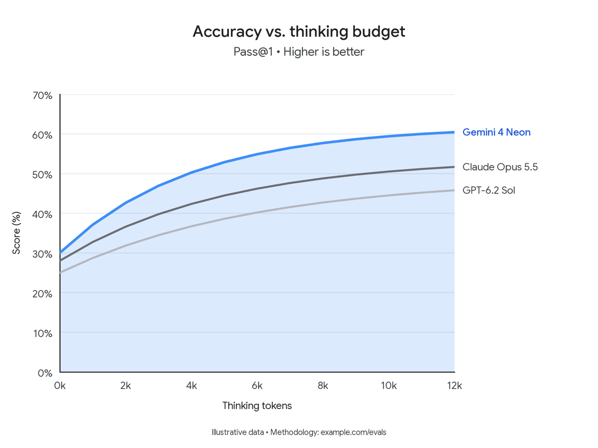

# clean-charts

A [Claude Code](https://claude.com/claude-code) skill that draws benchmark and comparison charts in the clean style of AI model-launch posts: one blue "hero" series, grey competitors, value labels on the bars, and a short methodology footer. It uses Python and matplotlib.



## Install

```bash
git clone https://github.com/zamminhduy123/clean-charts ~/.claude/skills/clean-charts
pip install matplotlib fonttools
python3 ~/.claude/skills/clean-charts/scripts/install_font.py   # optional: Google Sans
```

`install_font.py` downloads Google Sans from [google/fonts](https://github.com/google/fonts/tree/main/ofl/googlesans) under the SIL Open Font License. It then writes static Regular, Medium and Bold files, because matplotlib can't pick weights from a variable font. Without the font, charts fall back to Helvetica or Arial.

## Use

In Claude Code, ask for a chart in plain words:

> Make a clean bar chart: SWE-bench Verified — Model A 78.2%, Model B 80.1%, Model C 76.4%. Model A is ours.

> Recreate this chart in Python *(attach a screenshot)*

Claude picks the closest example below, fills in your data, renders the PNG, looks at it and fixes overlaps.

You can also use the helpers without Claude:

```python
import sys; sys.path.insert(0, "scripts")
from gstyle import *
setup()  # Google Sans, no mathtext, palette constants
```

## Chart types

| | |
|---|---|
|  Outlined bars |  Stacked k-attempt bars |
|  Cost vs. score lines |  Multi-panel slide |
|  Slide with metric cards |  Scatter + Pareto frontier |
|  Pie |  Doughnut |
|  Area |  Radar |

## Layout

```
SKILL.md            style rules + workflow Claude follows
scripts/gstyle.py   palette, axis styling, pixel canvas, rounded bars, pills
scripts/install_font.py
examples/*.py       one worked script per chart type (+ rendered .png)
```

## Disclaimer

This project is not affiliated with or endorsed by Google. It imitates a general visual style; it contains no Google logos or fonts.

The bar, line and slide examples recreate charts that Google published publicly:
- [Introducing Gemini 4 Neon](https://blog.google/innovation-and-ai/models-and-research/gemini-models/introducing-gemini-4-neon/)
- [Multimodal Knowledge Agents benchmark](https://blog.google/innovation-and-ai/models-and-research/gemini-models/multimodal-knowledge-agent-benchmark/)
- the Gemini 3 Deep Think announcement

Their numbers come from those posts, and some unlabeled segments were estimated from pixel heights. The pie, doughnut, area, scatter and radar examples use illustrative data.

## License

[MIT](LICENSE)
